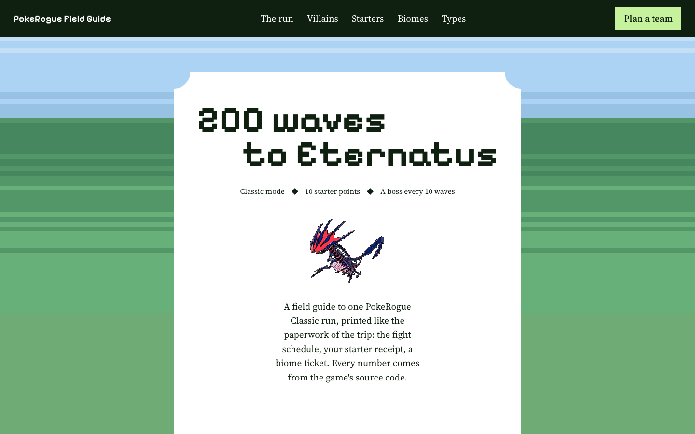

# PokeRogue Field Guide

**200 waves to Eternatus, mapped out.** A good-looking, interactive guide to a [PokeRogue](https://pokerogue.net) Classic run, printed like the paperwork of the trip.

**[Open the guide](https://zi-cong-tan.github.io/PokeRogue-Guide-Aesthetic/)**



## What's in it

- **Your run, right now.** Set your wave, biome, villain team and league region: see the next fight, which encounters can appear, where you can go, and boss prep (your team against the next boss, Pokémon by Pokémon). Pop it out into a small window that stays on top of the game.
- **The run, wave by wave.** Every fixed fight in Classic on one itinerary slip: rivals, gym leaders, the evil team, the Elite Four, the Champion and Eternatus. Click a fight to see the trainer.
- **The ten villain teams.** A case file per team, from Rocket to Star: boss and grunt sprites, admins by wave, both boss teams, and which Pokemon to watch out for (two health bars, Mega, Gigantamax).
- **Elite Four and Champions.** A run meets one region's whole league; every region's five fights with full teams, Megas, Tera types and bosses.
- **Spend your 10 points.** All 572 starters, searchable, with a receipt that adds up your party and checks its type coverage.
- **A build sheet for your party.** Pick ability (hidden included), passive, nature, IVs, shiny, unlocked egg moves and the four moves you start with. It warns you when an ability changes on evolving, and saves in your browser.
- **Mid-run help.** Set what each Pokemon has evolved into and the moves it knows now, chosen from everything it can learn (level-up, egg moves, TMs with their shop tier). Each one gets a suggested nature, a suggested moveset, and when to evolve, including moves to learn first because the next form can't.
- **A team check.** Which attack types hit most of your team, which types your moves can't hit hard, and who to swap out for what type.
- **Share your team** as a link. Opening one shows that team, with Undo to get yours back.
- **Save teams online** (optional). Sign in with GitHub or an email link to keep named teams across devices. Without signing in, everything still saves in your browser.
- **Builds, fusions and Megas.** Popular tactics (Leech Seed stall, setup sweeps, Belly Drum...) and which starters can really run them, the best DNA Splicer pairs for your party, and every Mega, Primal and Gigantamax form with its stats.
- **Candy and eggs.** Hatch times, what each gacha voucher promises, and candy costs per starter price.
- **Where can I go next?** All 34 biomes with their real art and the odds of each link.
- **Mystery Encounters.** All 29 in Classic with their game art: rarity, waves, biomes, every choice, what the battle and rewards really are, and which option to pick when.
- **The shop, Pokérus and fusion.** Every reward item by tier, how Pokérus spreads, and a fusion calculator using the game's own fusion maths.
- **Types.** Pick one or two types to see what hits them hard and what they hit hard.

## Browser extension

A read-only overlay for PokeRogue itself, in Chrome, Edge, Brave or Arc:

- **Damage beside your moves:** open Fight and each move shows its damage range and hits to KO, from the game's own damage calculation (abilities, items, IVs, weather, Tera and all). Works in double battles.
- **Catch odds beside each ball:** open Ball and each ball shows its chance to catch, from the game's catch formula, with an optional check of whether this turn's throw is caught.
- **Panels beside the game:** your run (wave, biome, next fight and boss), your team, the enemy's weaknesses, Mystery Encounter advice, and a tier badge on every reward item.

**[Download the extension zip](https://github.com/zi-cong-tan/PokeRogue-Guide-Aesthetic/releases/latest)**, unzip it, then in `chrome://extensions` turn on Developer mode and **Load unpacked** the folder. Full feature list and details in [`extension/README.md`](extension/README.md).

It isn't on the Chrome Web Store yet: publishing there has a registration fee I can't fund right now. If you'd like to sponsor it, [open an issue](https://github.com/zi-cong-tan/PokeRogue-Guide-Aesthetic/issues) and it can be a one-click install.

## Where the numbers come from

Everything is read from the [PokeRogue source code](https://github.com/pagefaultgames/pokerogue) (October 2026), not copied from wikis. The game updates often. `scripts/build-data.py` rebuilds the starter data (abilities, passives, moves, egg moves, evolutions, learnsets, TMs, base stats) from the latest source and flags anything that stopped matching. The suggested natures and movesets are rules of thumb built on that data (stats, move power, type coverage), not tier lists. If something looks out of date, please [open an issue](https://github.com/zi-cong-tan/PokeRogue-Guide-Aesthetic/issues).

## Run it yourself

```sh
npm install
npm run dev                     # local site
python3 scripts/build-data.py   # refresh starter, move and learnset data from the game source
node scripts/check-advice.mjs   # sanity check for the suggestions
npm run deploy                  # build and publish to GitHub Pages
```

Online saves use [Supabase](https://supabase.com) (free plan). To switch them on in your own copy: create a project, run `supabase/schema.sql` in its SQL editor, copy `.env.example` to `.env` with your project URL and anon key, and turn on the GitHub and Email sign-in providers. Without a `.env` the site works exactly the same, minus online saves.

Built with React, Vite, GSAP and Supabase.

## Credits

Made by [Zi Cong Tan](https://github.com/zi-cong-tan), built with Claude Code. A fan project, not affiliated with PokeRogue, Pagefault Games, Nintendo, Game Freak or The Pokemon Company.

- Biome, trainer, egg and candy art from [pokerogue-assets](https://github.com/pagefaultgames/pokerogue-assets) by Pagefault Games, [CC BY-NC-SA 4.0](https://creativecommons.org/licenses/by-nc-sa/4.0/). The tinted candy images in `public/sprites/` are adapted from it and stay under that licence.
- Pokemon sprites from [PokeAPI/sprites](https://github.com/PokeAPI/sprites).
- The code is MIT licensed (see `LICENSE`). The game art is not covered by it.
