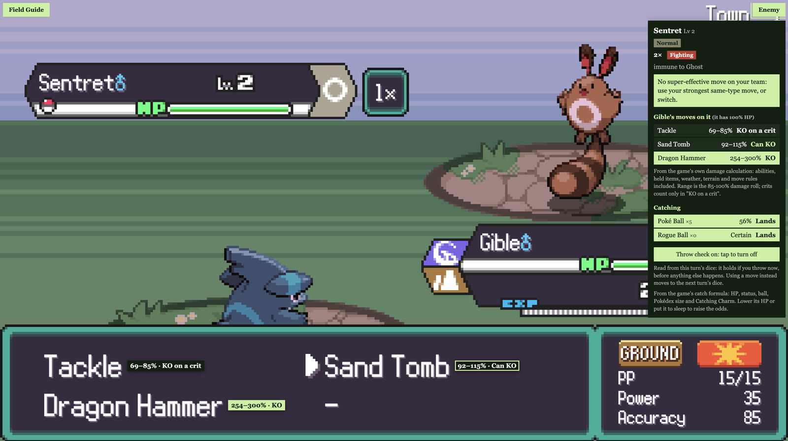
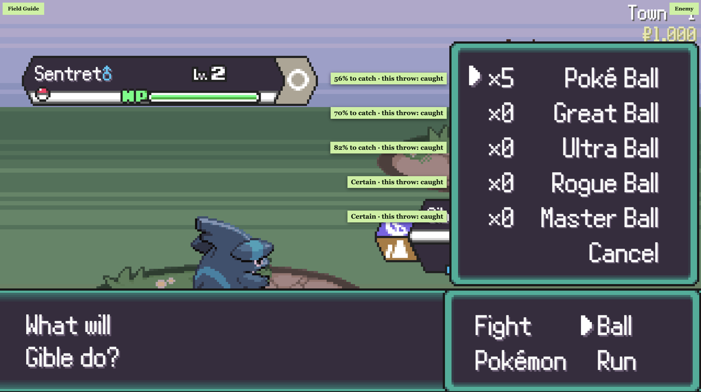
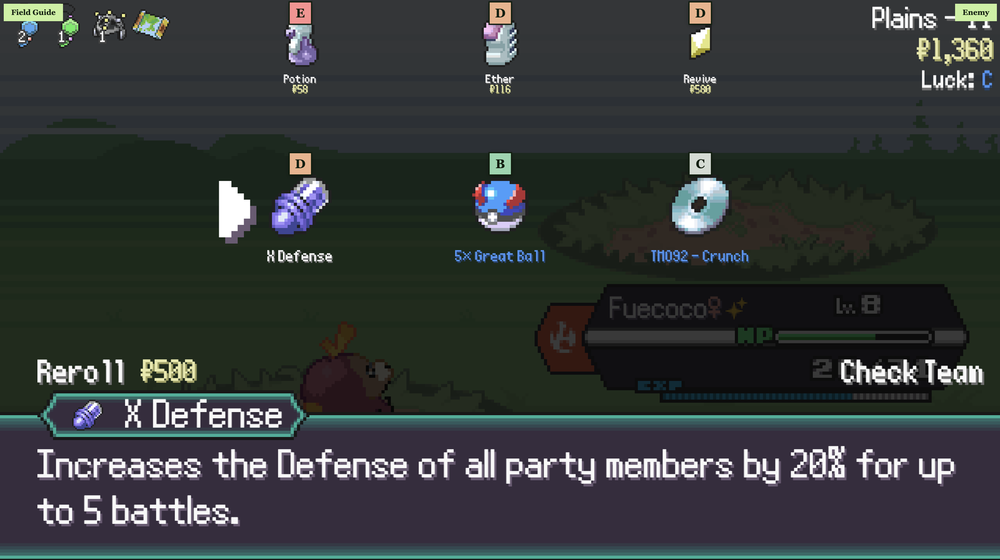

# PokeRogue Field Guide overlay (Chrome extension)

The second of the two Field Guides: this one runs inside the game while you play. The first is the
[website](https://zi-cong-tan.github.io/PokeRogue-Classic-Guide/) for planning a run.

A heads-up display for [PokeRogue](https://pokerogue.net), like a game overlay: panels in the empty bands beside the
game (or folded into corner tabs on small windows) that follow your run, plus small tags drawn right next to the game's
own menus.

## What it shows



- **Left panel:** wave, biome, next fight, next boss wave (with this biome's gym leaders), next biomes, luck; your team with
  HP and each member's best move against the enemy.
- **Right panel:** the enemy's weaknesses and the move to use, your active Pokémon's moves as a damage range (% of the
  enemy's HP) with KO / can KO / hits to KO. When a Mystery Encounter is on screen, its choices and which to pick instead.
  Out of battle, this biome's possible bosses.
- **Damage beside your moves:** open Fight and each move gets a tag right after its name, e.g. "26–31% · 4 hits".
  Lime means a sure KO. In double battles the tags follow whichever of your Pokémon is choosing, with a line per enemy.
- **Damage from the game itself:** the numbers come from the game's own damage calculation run in simulated mode, so
  abilities, held items, IVs, natures, stat changes, weather, terrain, Tera and each move's special rules are all in.
  The range is the 85–100% damage roll; "KO on a crit" covers crits.
- **Items that undo a KO:** if the enemy holds a Focus Band (10% per stack to hang on at 1 HP) or a Reviver Seed (back
  at half HP), the KO call says so.
- **Catch odds beside each ball:** open Ball and each ball gets its chance to catch, from the game's catch formula
  (HP, status, ball, Pokédex size, Catching Charm, and 2× for a shiny). "Certain" when the game skips the roll, and the
  reason when no ball can be thrown (trainer battle, two enemies, a boss with bars left).

  

- **Throw check (off by default):** the game's battle dice are fixed for each turn, so with this on, each ball also says
  whether this turn's throw is caught or breaks free. Never runs in Daily runs, which have a leaderboard.
- **Abilities when picking starters:** on the starter-select screen, a strip under the game's Ability box shows the
  ability the starter is set to and what it does, and follows you as you cycle with E. **All** opens the full list: both
  abilities, the hidden ability and the passive, each with its description and whether it's unlocked.
- **Reward screen:** a tier badge (S to E) on every item offered and in the shop, rated for your run: your wave, team HP,
  fainted Pokémon, types, moves, abilities and items you already hold. Hover a badge for the reason.

  

- **Every mode:** Classic shows its fixed fights; Endless and Spliced Endless show their own boss waves (Eternatus every
  250 waves, Eternamax every 1000); Daily hides the Classic-only fights.
- **Guide button:** items by tier with icons, every Mystery Encounter's advice, Mega and Gigantamax forms of your party,
  and a link to the [full guide](https://zi-cong-tan.github.io/PokeRogue-Classic-Guide/).

## Install (Chrome, Edge, Brave, Arc)

1. Download **`pokerogue-field-guide-extension.zip`** from the
   [latest release](https://github.com/zi-cong-tan/PokeRogue-Classic-Guide/releases/latest) and unzip it.
2. Open `chrome://extensions` (or `edge://extensions`) and turn on **Developer mode** (top right).
3. Click **Load unpacked** and pick the unzipped folder.
4. Open or reload [pokerogue.net](https://pokerogue.net). Click the **Field Guide** and **Enemy** tabs to open or fold
   each panel.

To update, download the new zip, replace the folder, and click the ↻ button on the extension's card.

### Why not the Chrome Web Store?

It could be there, so installing would be one click. Publishing on the Chrome Web Store needs a Google developer
account with a registration fee, and I don't have the funds for it right now. If you'd like to sponsor it, please
[open an issue](https://github.com/zi-cong-tan/PokeRogue-Classic-Guide/issues) and I'll put it up. Until then,
the zip above is the same extension.

## Read-only, and what it reads

It reads `window.gameInfo`, which the game publishes itself (mode, biome, wave, luck, your party), plus, from the battle
itself: the enemies on the field (name, level, HP, types, boss bars, held items that can undo a KO) and which Mystery
Encounter is on screen. It never changes the game, never sends anything anywhere, and never shows the enemy's moves.
Damage comes from the game's own calculation in simulated mode; the throw check replays the enemy's move choice and the
capture rolls, then puts the dice back exactly as they were.

After a game update, if the enemy part stops filling in, the rest (your party, wave, biome) keeps working.

## Build it yourself

```sh
npm install
npm run build:extension   # writes extension/dist; load that folder unpacked
```
